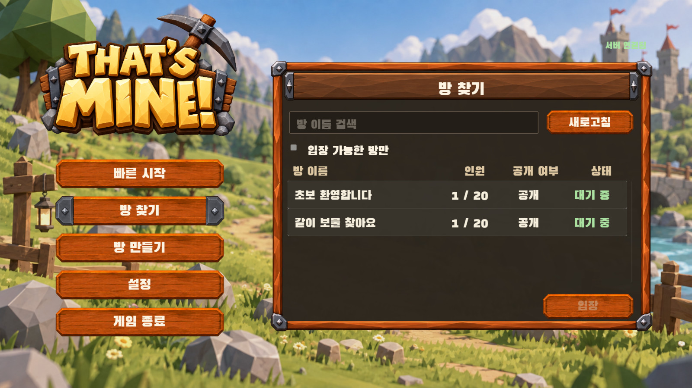
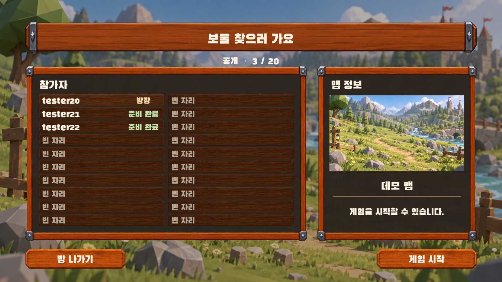
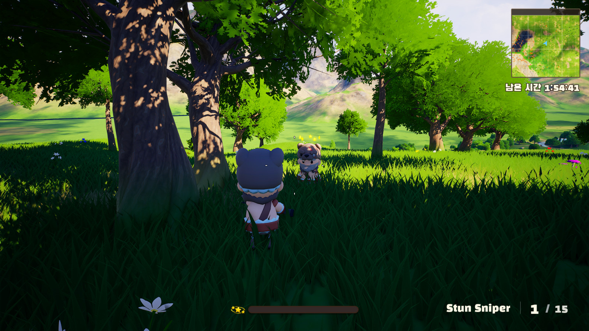
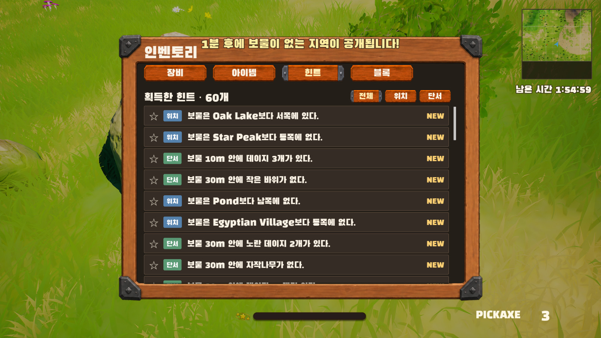
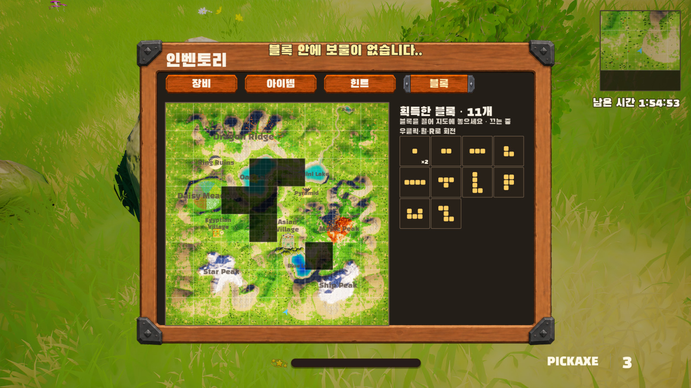
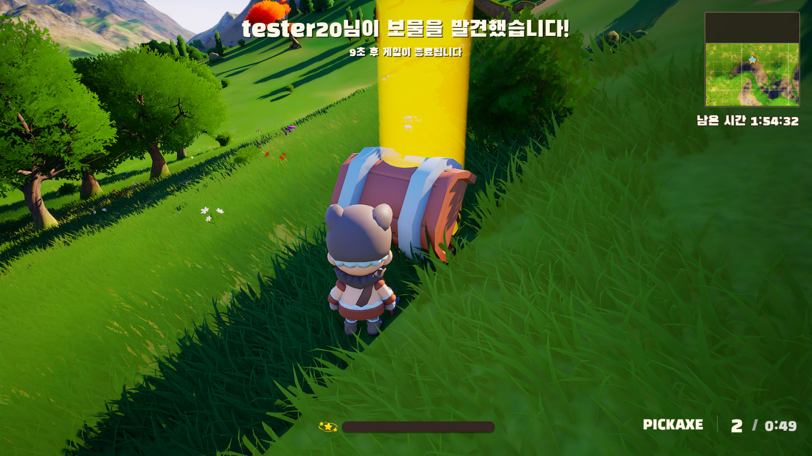
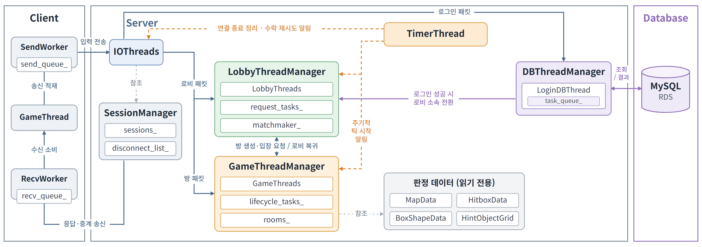

# That's Mine — 20인 3인칭 보물찾기 대전 게임

**C++ IOCP 게임 서버와 언리얼 엔진 5 클라이언트를 구현한 개인 프로젝트**입니다.
[테트리스 멀티플레이 서버](https://github.com/givoontake/project_tetris)에서 다진 서버 구조를 3D 멀티플레이 게임에 옮기고, 이동·사격 판정을 서버가 직접 맡도록 만드는 데 집중했습니다.

- **개발자:** 강은혁
- **제작 기간:** 2026.09.10 ~ 2026.10
- **개발 범위:** 게임 서버, 언리얼 클라이언트, 통신 프로토콜, 데이터베이스 연동, 판정용 데이터 추출 도구, 부하 테스트 클라이언트
- **게임 규칙:** 최대 20명이 한 맵에서 상자를 열어 힌트를 모으고, 사격으로 상대를 기절시켜 힌트를 빼앗으며, 먼저 보물을 찾는 사람이 승리합니다.
- **주요 기능:** 방 생성·참가 및 빠른 매칭, 상자·힌트·블록 배제 판, 사격·기절, 시상식

## 클라이언트 화면

| 로비 | 방 | 플레이 - 기절 |
| --- | --- | --- |
|  |  |  |

| 플레이 - 힌트 | 플레이 - 블록 | 게임 종료 |
| --- | --- | --- |
|  |  |  |

## 기술 스택

| 구분 | 사용 기술 |
| --- | --- |
| Server | C++ · Windows · IOCP(입출력 완료 포트) · Winsock2 · TCP(전송 제어 프로토콜) · oneTBB |
| Client | Unreal Engine 5 · C++ |
| Database | MySQL · Amazon RDS(관계형 데이터베이스 서비스) |
| Authentication | bcrypt 비밀번호 해시 검증 · Botan |
| Test | Python 시험 봇 · C++ IOCP 부하 테스트 클라이언트 |
| Tools | Visual Studio · CMake · Git · GitHub |

## 서버 처리 구조



- **네트워크:** IO 스레드가 입출력 완료를 처리하고, 받은 패킷을 그 순간의 세션 소속에 따라 로그인 DB 스레드, 로비 요청 큐, 방 패킷 큐 중 한 곳에 넣습니다. 처리하는 쪽은 지금도 자기 소속인 세션의 패킷만 처리합니다.
- **로그인:** 로그인 DB 스레드가 요청을 받아 계정 조회와 비밀번호 확인을 하고, 성공하면 로비 소속으로 바로 전환합니다. DB 연결이 끊기면 다시 연결하고, 너무 오래 기다린 요청은 시간 초과로 응답합니다.
- **로비:** 로비 스레드 둘이 요청 큐를 나눠 처리하고, 마지막으로 끝낸 스레드가 빠른 매칭을, 다른 스레드가 방 목록 갱신을 맡습니다.
- **게임:** 타이머가 목표 50Hz(초당 50회), 20ms 간격으로 틱을 시작합니다. 방은 고정 배열에 두고, 게임 스레드들이 방 단위로 나눠 처리합니다.
- **연결 종료:** 종료는 예약만 해 두고, 타이머가 1초마다 맡기는 정리를 IO 스레드 한 곳에서 처리합니다.
- **판정 데이터:** 서버 시작 때 지형·충돌 모양·히트박스·상자 모양 데이터를 읽어 두고, 모든 방이 읽기 전용으로 함께 씁니다.

## 테트리스 서버 구조에서 개선한 점

1. **처리 단위 작업 큐:** 플레이어마다 따로 모아 두던 요청을 처리 단위(로그인·로비·방)마다 들어온 순서대로 모으도록 바꿔, 거의 동시에 들어온 요청을 자리 번호가 아니라 먼저 보낸 순서대로 처리합니다.
   구현: [GameServer::RoutePacket](Server/Core/GameServer.cpp) · [GameRoom](Server/Rooms/GameRoom.cpp)
2. **연결 종료 정리 일원화:** 로비와 방이 각자 하던 뒷정리를, 세션 관리자의 종료 후보 목록과 1초 주기 정리로 모았습니다. 로비와 방을 옮기던 중에 끊겨도 정리가 미뤄지며 반복되던 부분을 구조적으로 개선했습니다.
   구현: [SessionManager](Server/Network/SessionManager.cpp) · [GameServer::ProcessDisconnects](Server/Core/GameServer.cpp)
3. **패킷 검증 강화:** 전체 길이만 확인하던 방식을, 패킷 종류마다 허용 크기 표로 검사하도록 바꿨습니다.
   구현: [packet_size_table.h](Server/Network/packet_size_table.h)
4. **방 목록 갱신 방식 변경:** 요청마다 모든 방을 돌며 목록을 만들던 것을, 1초마다 새 목록을 만들어 `shared_ptr`로 원자적으로 교체하고 요청에는 만들어 둔 목록을 보내도록 바꿨습니다.
   구현: [LobbyThreadManager](Server/Threads/Managers/LobbyThreadManager.cpp)

## 주요 문제와 해결

### 1. 서버가 판정에 쓸 맵 데이터가 언리얼 안에만 있는 문제

**문제:** 서버가 이동과 명중을 직접 판정하려면 지형 높이, 충돌 모양, 캐릭터 히트박스와 애니메이션이 필요했지만, 이 정보는 언리얼 에셋 안에만 있었습니다.

**해결:** 언리얼 커맨드릿으로 지형 조각 288개, 충돌 모양 299종, 캐릭터 히트박스와 동작 20개를 뽑는 추출 도구를 만들어 서버 판정에 사용했습니다. 추출한 데이터를 언리얼에서 같은 동작을 재생한 결과와 비교해, 뼈 위치는 0.5cm, 각도는 0.22° 안에서 일치함을 확인했습니다.

구현: [LocalMapExport 플러그인](Client/Plugins/LocalMapExport) · [MapData](Server/Game/Map/MapData.cpp) · [HitboxData](Server/Game/Hitbox/HitboxData.cpp)

### 2. 원격 캐릭터가 멈출 때 지나쳤다 되돌아오는 문제

**문제:** 다른 플레이어의 캐릭터는 받은 키 입력으로 움직이는데, 키를 뗀 소식이 지연만큼 늦게 도착하는 동안 계속 달려가, 멈춘 뒤 원래 위치로 되돌아오는 움직임이 보였습니다.

**해결:** 보낸 사람이 키를 뗀 위치와 속도를 함께 보내고, 받는 쪽은 엔진과 같은 제동식으로 멈출 자리를 계산해 엔진의 감속으로 그 자리에 서게 했습니다. 늦게 도착한 만큼의 차이를 되돌아가는 대신 감속 속에 가렸습니다. 멈춤 12번 측정에서 되돌아가는 거리는 평균 4.6cm에서 0.5cm로, 지연이 0~40ms 흔들릴 때는 평균 8.8cm에서 0.9cm로 약 90% 줄었습니다.

구현: [RemoteMovementComponent](Client/Source/ThatsMine/Player/RemoteMovementComponent.cpp) · [MovementSyncSubsystem](Client/Source/ThatsMine/Network/MovementSyncSubsystem.cpp)

### 3. 고정 여유 때문에 발사 간격이 틀리게 판정되는 문제

**문제:** 처음에는 서버가 처리한 시각의 간격에서 매 발 150ms 여유를 빼 줘서, 지연이 흔들리면 정상 연사가 거부되고, 반대로 0.2초 간격 권총을 50ms마다 쏴도 통과했습니다.

**해결:** 클라이언트가 서버 기준 동작 시각을 보내게 하고 동작 시각의 간격으로 판정하되, 서버가 늦게 받은 만큼은 보상으로, 일찍 받은 만큼은 빚으로 쌓아 지연의 흔들림만 봐주고 시각을 앞당기는 조작은 빚으로 걸러지게 했습니다.

구현: [PlayerActionState](Server/Game/PlayerActionState.cpp)

### 4. 클라이언트가 정한 명중을 서버가 대조만 하여 조작이 가능했던 문제

**문제:** 처음에는 클라이언트가 명중과 부위를 정해 보내고, 서버는 같은 시드로 퍼짐을 다시 계산해 0.1° 안인지 대조만 해서, 시드를 아는 클라이언트는 퍼짐을 미리 상쇄할 수 있었습니다.

**해결:** 시드는 서버만 갖고 클라이언트는 퍼지기 전 조준과 카메라 위치만 보내며, 서버가 퍼짐을 정한 뒤 사격 시각으로 상대를 되감아 추출한 히트박스에 광선을 쏘아 판정하게 했습니다. 좌우로 움직이는 상대를 저격한 봇 시험에서 지연 0·30·60ms 모두 100% 명중으로 판정했습니다.

구현: [GameRoom::ProcessFire](Server/Rooms/GameRoom.cpp) · [hitbox_raycast](Server/Game/Hitbox/hitbox_raycast.cpp)

## 부하 테스트

### 실행 환경

- **하드웨어:** Intel Core i5-13600KF(14코어 / 20스레드 / 3.5GHz) · 메모리 32GB · Windows 11 Home
- **방식:** 자체 제작 IOCP 부하 테스트 클라이언트, 로컬 서버 / 로컬 클라이언트
- **조건:** 20인 방 구성, 클라이언트는 0.1초 간격으로 이동, 1초 간격으로 권총 발사를 전송, 데이터베이스 처리 우회
- **측정:** 목표 인원 게임 진입 후 30초 측정, 인원별 1회. 이동은 보낸 이동이 중계되어 돌아오기까지, 발사는 탄약 사용 알림을 받기까지의 지연시간

### 결과

| 플레이 인원 | 이동 평균 | 이동 P99(99백분위) | 발사 평균 | 발사 P99 |
| ---: | ---: | ---: | ---: | ---: |
| 10,000명 | 12.88ms | 36ms | 16.17ms | 42ms |
| 11,000명 | 14.85ms | 41ms | 18.77ms | 48ms |
| 12,000명 | 15.83ms | 42ms | 19.17ms | 47ms |
| 13,000명 | 18.04ms | 48ms | 21.17ms | 52ms |
| 14,000명 | 18.99ms | 50ms | 22.41ms | 56ms |

구현: [Stress](Stress)

## 향후 개선

1. **게임 중 재접속:** 게임 중 연결이 끊긴 플레이어의 자리를 일정 시간 남겨 두고, 같은 계정이 다시 접속하면 진행 중인 게임으로 복귀
2. **거리별 이동 중계 빈도 조절:** 멀리 있는 플레이어의 이동 상태는 틱마다 보내지 않고 거리에 따라 보내는 주기를 늘려, 받는 사람마다 매 틱 방 전원의 이동을 받던 송신량 감소
3. **통신 구간 암호화:** 로그인 비밀번호를 포함한 모든 패킷이 평문으로 오가므로, 암호화를 적용해 도청 및 변조 방지

## 빌드와 실행

### 서버

Visual Studio 2022 C++ 도구, CMake 3.21 이상, oneTBB, Botan, MySQL Connector/C++(JDBC)가 필요합니다. 라이브러리 경로는 설치 위치에 맞춰 지정합니다.

```powershell
cmake -S Server -B Server/Build -G "Visual Studio 17 2022" -A x64 -DCMAKE_PREFIX_PATH="C:/vcpkg/installed/x64-windows" -DMYSQL_CONNECTOR_ROOT="C:/Program Files/MySQL/MySQL Connector C++ 9.5"
cmake --build Server/Build --config Release --parallel
```

`Server/db_config.example.txt`를 `Server/db_config.txt`로 복사해 접속 정보를 넣고, `Server` 폴더를 작업 폴더로 해서 `Server/Build/Release/GameServer.exe`를 실행합니다. 실제 설정 파일은 버전 관리에서 제외됩니다.

### 클라이언트

Unreal Engine 5.8로 `Client/Thats_Mine.uproject`를 엽니다. 서버 패킷 정의(`Server/Packets`)와 공용 설정(`Server/Common`)을 클라이언트가 함께 씁니다.

### 부하 테스트 클라이언트

```powershell
cmake -S Stress -B Stress/Build -G "Visual Studio 17 2022" -A x64
cmake --build Stress/Build --config Release
Stress/Build/Release/Stress.exe <서버 IP> <클라이언트 수> <결과 폴더>
```

부하 테스트는 데이터베이스를 거치지 않는 시험 로그인으로 접속합니다. 시험 로그인은 배포용 서버에 넣지 않았으므로, 측정할 때는 서버에 시험 로그인 처리를 임시로 추가해야 합니다.

## 저장소 구성

| 폴더 | 내용 |
| --- | --- |
| `Server` | IOCP 게임 서버 |
| `Client` | 언리얼 엔진 5 클라이언트 |
| `Client/Plugins/LocalMapExport` | 서버 판정용 데이터 추출 도구 |
| `Stress` | 부하 테스트 클라이언트 |
| `Docs/Images` | README 이미지 |
